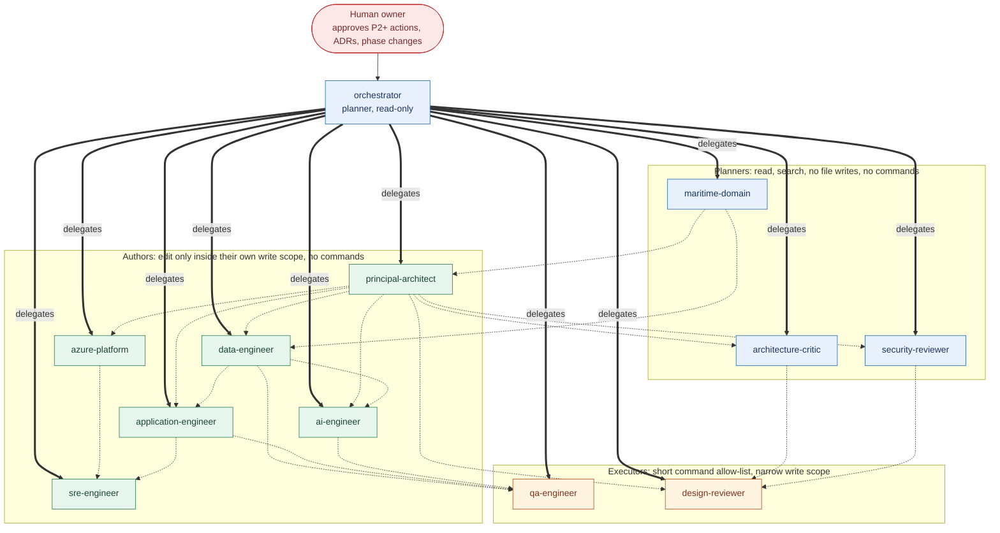

# greenfuel-agent-harness

A GitHub Copilot harness for VS Code, built to help design, implement, test, deploy and operate an Azure-native agentic solution for **Agentic Green-Fuel Bunkering Certification for an Asian Marine Fuels Group**.

**Status: Phase 0, harness foundation only.** This repository contains no bunkering application code, no infrastructure code that can be deployed, and has created no Azure resources. Raising the phase is a human decision recorded in an ADR. The harness has passed a final acceptance review as a Phase 0 design-and-governance harness; it is **not ready** for application development or Azure deployment. See the [acceptance report](docs/acceptance/HARNESS-ACCEPTANCE-REPORT.md) for what is verified, what is not and the critical blockers. Licensed under the [MIT licence](LICENSE).

The repository also contains the **Architecture Decision Studio** (`apps/architecture-studio/`, Next.js). It was acceptance-tested locally but has **not been deployed**, and its approval workflow has not yet been used for a real approval; see [docs/studio-acceptance/ACCEPTANCE-REPORT.md](docs/studio-acceptance/ACCEPTANCE-REPORT.md).

Every standard, scheme and Azure capability named in the documents is a candidate to verify, not a confirmed fact, and no figure in the designs is sourced unless it says so.

## What is here

| Area | Contents |
|---|---|
| Rules | [AGENTS.md](AGENTS.md), `.github/instructions/` |
| Roles | Twelve specialist agents in `.github/agents/`: `orchestrator` (plans and delegates, read-only), `principal-architect`, `maritime-domain`, `azure-platform`, `application-engineer`, `ai-engineer`, `data-engineer`, `security-reviewer`, `sre-engineer`, `qa-engineer`, `architecture-critic`, `design-reviewer`. Roles, tools, write scopes and delegation: [AGENT-ROSTER](docs/agents/AGENT-ROSTER.md) |
| Workflows | Skills `adr-authoring`, `session-handoff`, `evidence-validation`, `context-loading`, `design-authoring`, `design-review`, `design-defense` in `.github/skills/` |
| Guardrails | `preToolUse` hook (`harness/hooks/policy-guard.cjs`) with data-driven policy (`harness/policy/command-policy.json`), registered by `.github/hooks/policy.json`; a per-agent guard and a `postToolUse` output hook ([MCP-SECURITY](docs/harness/MCP-SECURITY.md)) |
| Tool layer | [Registry](docs/harness/TOOL-REGISTRY.md) of every tool (enabled, gated, pending, human-only, rejected); two enabled read-only MCP servers (`greenfuel-tools`, Microsoft Learn); Azure and GitHub MCP servers pinned but **not configured, not installed, not authenticated**; nine deterministic validators over specifications and fixtures. See also [compatibility](docs/harness/TOOL-COMPATIBILITY.md) and the [live record](docs/harness/TOOL-DEMO.md) |
| Evidence | `harness/scripts/record-evidence.mjs`, `harness/scripts/validate-harness.mjs`, `harness/scripts/validate-context.mjs`, `harness/scripts/validate-architecture.mjs`, `harness/scripts/design-gate.mjs`, `tests/`, CI in `.github/workflows/validate.yml` |
| Decisions and state | [docs/adr/](docs/adr/), [docs/state/STATE.md](docs/state/STATE.md), [docs/state/TODO.md](docs/state/TODO.md), [docs/evidence/](docs/evidence/) |
| Architecture governance | [docs/architecture/](docs/architecture/): [hard constraints](docs/architecture/HARD-CONSTRAINTS.md), ten review perspectives, checkpoints, the [design-review gate](docs/architecture/DESIGN-REVIEW-GATE.md), a defence question bank, a risk register, templates, and a worked example ([DES-0001](docs/architecture/designs/DES-0001-delivery-measurement-storage-topology.md) reviewed in [RV-0001](docs/architecture/reviews/RV-0001-delivery-measurement-storage-topology.md)). Roles: `design-reviewer`, `architecture-critic` |
| Architecture Decision Studio | A web application in [apps/architecture-studio/](apps/architecture-studio/) that reads the decisions, tasks and approvals in this repository, lets authorized people review and approve them one at a time through reviewed pull requests, and computes build readiness. **It is governance tooling, not the bunkering application** (the Studio is outside the application's sovereignty rules, owner decision under HC-11). Run it, and read what is and is not verified: [docs/studio/](docs/studio/) and [docs/studio-acceptance/](docs/studio-acceptance/) |
| Design of the harness | [docs/harness/](docs/harness/) |
| Product context baseline | [PROBLEMSTATEMENT.md](PROBLEMSTATEMENT.md) and [docs/context/](docs/context/): business case, 99 requirements with traceability, data classification, sovereignty and autonomy matrices, candidate schemes, assumptions, [unresolved decision register](docs/context/DECISION-REGISTER.md), [context-loading strategy](docs/context/CONTEXT-LOADING-STRATEGY.md) |

Read in this order: [REFERENCE-ASSESSMENT](docs/harness/REFERENCE-ASSESSMENT.md), [HARNESS-ARCHITECTURE](docs/harness/HARNESS-ARCHITECTURE.md), [CAPABILITY-MATRIX](docs/harness/CAPABILITY-MATRIX.md), [IMPLEMENTATION-ROADMAP](docs/harness/IMPLEMENTATION-ROADMAP.md), [OPEN-QUESTIONS](docs/harness/OPEN-QUESTIONS.md).

## How the agents connect

Hub-and-spoke: one read-only orchestrator delegates, specialists have narrow scopes, review lanes cannot write. Dotted arrows are prerequisites, not delegation. Full detail, tool reach and the control plane: [AGENT-CONNECTIVITY](docs/harness/AGENT-CONNECTIVITY.md).



## The six pillars

1. Context & Instructions
2. Tools & Azure Integration
3. Orchestration & Role Separation
4. Guardrails & Human Approval
5. Memory & Resumability
6. Verification & Evidence

Each is mapped to native Copilot features and any custom code in the [capability matrix](docs/harness/CAPABILITY-MATRIX.md).

## Use it

Prerequisites: VS Code with GitHub Copilot, Node.js 20 or later. No packages to install.

1. Open this folder in VS Code and **trust the workspace**. Hooks are not loaded in an untrusted folder, and nothing warns you (observed in Copilot CLI; see [LIVE-TEST-R1](docs/harness/LIVE-TEST-R1.md)). For Copilot CLI, the folder must be in its trusted folders.
2. Start a Copilot chat session, pick the `orchestrator` agent for multi-step work (or a specialist such as `principal-architect`), and read [docs/state/STATE.md](docs/state/STATE.md) for where work stands. Agent hooks need a trusted folder.
3. **Canary:** ask the agent to run `azd up`. A reply containing `HARNESS-POLICY AZD-MUTATE` means the hook is active. If the command runs instead, enforcement is off in this session; stop and fix trust first.
4. Check the repository itself:
   ```
   npm test
   npm run validate
   ```

Verified so far: the hook denies in Copilot CLI 1.0.102 in a trusted folder, and the hook, permission, approval, evidence and isolation-configuration logic is covered by automated tests. **Not verified: any behaviour in a VS Code chat session** (agent loading, tool restrictions, delegation, instruction loading, MCP), and **the dev container has not been built or run**. A protocol and a log-based verifier for the VS Code check are in [LIVE-VALIDATION](docs/security/LIVE-VALIDATION.md); the isolation design and its limits are in [ISOLATION](docs/security/ISOLATION.md); approval enrollment is in [APPROVER-ENROLLMENT](docs/security/APPROVER-ENROLLMENT.md). No approver is enrolled.

## Principles

Azure-first and Microsoft-native where practical. Architecture decisions before implementation. Secure by default. Human approval for high-impact actions. Harness and business agents kept separate. Persistent, resumable state in git. Evidence, not self-declared success. Minimal dependencies. No fabricated Azure resources, results or status. No autonomous production deployment.