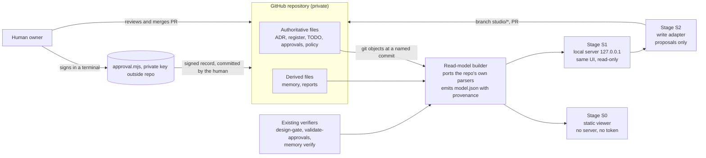

# Integration design

Status: **discovery recommendation, 2026-10-29. Nothing is built and nothing here is approved.** This document recommends the safest way to build an Architecture Decision Studio that reads from, and later writes back to, this GitHub repository. It reuses the existing governance. It adds no new approval system.

## 1. What the repository imposes on any integration

| Fact (from the discovery) | Consequence for the design |
|---|---|
| The authoritative decision records are Markdown (ADRs, a register table, TODO rows). No structured status exists for tasks | The studio must **parse Markdown conventions** and mark every derived value as derived |
| The **only** machine-readable decision store is `memory/`, and it is derived and lags (no ADR 0016 to 0020) | Do not use memory as the read source. It can be shown as a cross-check |
| A signed decision approval exists as a mechanism (`greenfuel.decision-approval/v1`, Ed25519, human-only) but **0 approvers and 0 records exist** | The studio must **never** hold a key, sign, or mark anything approved. It generates requests and verifies results |
| ADRs 0001 to 0015 are **grandfathered** (accepted in chat, unsigned); a new ADR needs a signature | Show provenance on every accepted record. Never write `Accepted` |
| Control-plane paths (`harness/`, `.github/`, `docs/approvals/`, `memory/`, `package.json`, `evaluation/` and more) are agent-write-denied | The studio may not write them. Neither may an agent build the studio there |
| `origin/main` is **24 commits behind** the authoritative branch | Read a **named commit**, show "behind main", and make the merge path an owner decision |
| **Branch protection is unavailable** (HTTP 403 on this plan); CODEOWNERS is inactive; `control-plane-owners.json` is empty and `enforce: false`; CI runs only on `main` pushes and pull requests | Nothing technical stops a push to `main`. **The studio must make writing to `main` impossible by construction**, because the platform will not |
| Phase 0: application paths are denied to agents; **HC-11 forbids an application build before a human raises the phase** | Whether a web studio counts as "the application" is a **question for the owner** (OQ-1). It is harness tooling that holds no bunkering data, but the text of HC-11 does not say so |
| No Azure resource, tenant or subscription is approved (T36, T37) | **No hosted deployment.** The studio runs locally |
| The repository has **no dependencies** and a documented preference for minimal ones | Every added dependency (UI framework, bundler) is a recorded decision with a pinned lockfile |

## 2. Options considered

| Option | Read | Write-back | Safety | Effort | Fit with the repository |
|---|---|---|---|---|---|
| **A. Static viewer built from a snapshot** (generate `model.json` and a self-contained HTML, open from disk) | Yes, at a named commit | None | **Highest.** No server, no token, no network | Low | Same approach as the existing deck and snapshot; no new dependency beyond a bundler (or none) |
| **B. Local web app, read-only** (Node on `127.0.0.1`, reads Git objects) | Yes | None | High | Medium | Adds a server process |
| **C. Local web app with pull-request write-back** (B plus a write adapter that creates a branch, commits a *proposal*, pushes and opens a PR using the user's own Git credentials) | Yes | Proposals only, reviewed by the owner in GitHub | **Medium-high if the write allowlist is enforced in code and tested** | Medium-high | Matches "read from and write back"; relies on the owner's PR review, the only gate that exists |
| D. VS Code extension (webview) | Yes | via the editor's Git | Medium: runs with the editor's privileges and the Copilot environment | Medium | Native to the user's tools, but a "premium web interface" is easier in a browser, and extension hosts widen the attack surface |
| E. Hosted web app (for example Azure Static Web Apps plus a GitHub App with write permission) | Yes | direct API writes | **Lowest.** Needs a secret, a GitHub App with repository write on a repository whose `main` is unprotected, a tenant and a subscription | High | **Rejected for now**: needs T36 and T37 decided, creates Azure resources, and a write-capable app is the most dangerous component to place next to an unprotected `main` |

## 3. Recommendation: build A, then C, behind one read model

The safest architecture is **one deterministic read model with three consumers, introduced in stages**:

### 3.1 Read model builder (the core)

- **Input:** a **commit SHA**, read with `git cat-file` / `git show`, **not the working tree**. The UI always displays the SHA, the branch it came from, and how far that commit is behind `origin/main`.
- **Parsers:** the rules R-01 to R-25 in [DATA-MAPPING](DATA-MAPPING.md), implemented by **reusing** `validate-context.mjs`, `design-gate.mjs`, `approval-gates.cjs` and `memory.mjs verify` (spawned read-only), not by re-implementing them. The prototype is `harness/scripts/studio-inventory.mjs`.
- **Output:** `model.json` (generated, derived, never edited) with provenance on every record and a `review` list for anything ambiguous.
- **Determinism:** the same SHA gives byte-identical output. A golden test pins the counts in [DECISION-INVENTORY](DECISION-INVENTORY.md) at `392ac02`.

### 3.2 Interface (S0 and S1)

A React and TypeScript front end, restrained and accessible. Screens: Overview (counts, blockers, "what is stopping us"), Decisions (the 37 and the 20 with provenance chips), Tasks, Approvals (an **honest empty state**: no approver, no signed record), Assumptions, Risks, Dependencies (declared edges solid, mentioned edges dashed), Review queue (the ambiguous items), Evidence, and a Proposals tab in S2. Rules: no decorative chart without a count behind it, no invented progress figure, every number links to its source line and rule id, and Markdown is rendered through a sanitiser with raw HTML disabled.

### 3.3 Write adapter (S2): proposals only

The studio **cannot approve anything.** It can only prepare changes for the owner to review in a GitHub pull request.

| It may | How |
|---|---|
| Draft a new ADR with `Status: Proposed` | new file `docs/adr/NNNN-*.md` from the template; next number computed from the baseline |
| Record a proposed answer, challenge or rejection against a decision, task, assumption or risk | a new **annotation** file under `docs/architecture-studio/annotations/` (non-authoritative, schema-validated, ignored by every gate) |
| Propose a task status change | a one-row edit to `docs/state/TODO.md` in the PR, shown as a diff |
| Prepare an approval request | print the exact command `node harness/scripts/approval.mjs decision --type adr --id <id> --reason "..." --out docs/approvals/AP-x.json`; the human runs it and signs in their own terminal |

| It must refuse, in code, with a test for each | |
|---|---|
| Any write to `main`, or any push to a branch not named `studio/*` | |
| Any path outside the allowlist (`docs/adr/` new files, `docs/architecture-studio/annotations/`, `docs/state/TODO.md`) | |
| Any path in a control-plane class (`harness/`, `.github/`, `docs/approvals/`, `memory/`, `package.json`, `.vscode/`, `.mcp.json`, `evaluation/`) | |
| Editing an existing `- **Status:**` line, or writing the words Accepted, Approved or Rejected as a status | |
| Editing an existing ADR that is Accepted | |
| Changing a decision-register `Status` | |
| Storing, reading or transmitting a private key, passphrase or token | |
| Writing when the file changed on the remote since it was read (optimistic concurrency on the file SHA) | |

**Authentication.** The app uses the user's existing Git and GitHub CLI credentials through the operating-system credential helper. It stores no token. If a token is ever needed it is a fine-grained, per-repository, contents-only token created by the owner, entered per session and held in memory only.

**After the pull request.** The studio re-reads the new commit, re-runs the gate and the approval verifier, and shows the result. A state is displayed as approved **only if the existing verifier says so**.

### 3.4 Why not write directly to `main`, and why not a bot

- `main` has no protection and CI only detects. A direct-write path would turn one UI bug or one stolen session into an unreviewed change to the control plane.
- A machine account with write access would recreate the problem `github-protection.json` already lists as unspecified ("a separate machine account with no merge or admin rights... none exists").
- A pull request is the **one review gate that exists today**, and the owner already uses it.

## 4. Threat model (summary)

| Threat | Control |
|---|---|
| Malicious Markdown in a record (script, link, image beacon) | Sanitise; disable raw HTML; no remote images or fonts; strict Content-Security-Policy; no `eval` |
| Path traversal or a symlink in a write request | Resolve and compare to the allowlist after canonicalisation; refuse symlinks |
| Local server abused by a web page the owner visits | Bind to `127.0.0.1` on a random port; per-session token in a header; no CORS; `Host` and `Origin` checks |
| The studio becomes a path to approve or accept something | No write of status words; no key handling; every accepted state is recomputed by the harness verifier |
| Stale view leads to a wrong decision | SHA and "behind main" banner; refuse writes on a stale base |
| Supply-chain compromise of the UI toolchain | A recorded dependency decision; lockfile; `npm ci --ignore-scripts`; pinned versions; no postinstall; review the dependency list with the owner (the repository has none today) |
| Secrets in records or logs | Reuse the repository's redaction patterns (`secret-patterns.json`); never log record bodies |
| An agent building the studio widens its own permissions | The studio lives outside the control plane; any agent-write entry is an owner change in `agent-policy.json` |
| AI features introduce injection | **None in S0 to S2.** Any model use needs its own ADR |

## 5. Where it lives

**Recommendation: a top-level folder `studio/` in this repository**, not a second repository, for the same reason the owner chose a folder for Phase 1a: the hooks, policy, CI and evidence recorder already apply, and a second repository would need all of them reproduced. Costs: it adds code to the repository whose audit found governance volume outstripping product code (gap G-16), and the folder is not yet in any agent's write list. A separate repository is the alternative and needs the owner's decision (OQ-1).

## 6. Integration with CI and branches

- The read-model builder and its golden tests run in the existing `npm test`. Adding them to `validate.yml` is a **control-plane change the owner makes**.
- CI does not run on pushes to feature branches. Until a pull request exists, nothing validates a `studio/*` branch, so the write adapter **opens the pull request as part of the write** and the studio waits for the result.
- If branch protection later becomes available, `github-protection.json` already specifies it; the studio needs no change.

## 7. Failure modes and how they surface

| Failure | Behaviour |
|---|---|
| A record cannot be parsed | Shown under "Review queue" with the file, line and rule; never dropped |
| A parser rule and the repository's own validator disagree | The validator wins; the studio shows both and flags the rule |
| The remote moved | Read banner; writes refused until the base is refreshed |
| `gh` is not signed in | Read-only mode; writes disabled with the reason |
| The owner's key is not enrolled | The Approvals screen shows "no approver is enrolled" and links to the enrollment guide; it offers no workaround |
