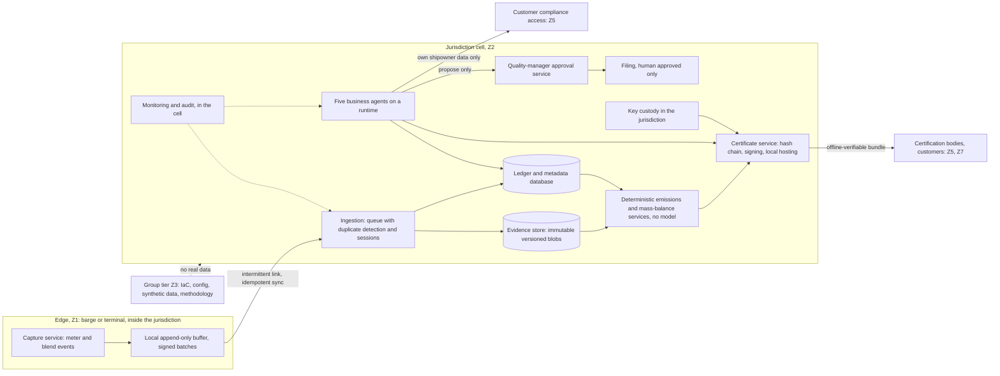

# Azure reference architecture

Status: **proposed, provisional, Phase 0.** This is a candidate reference architecture. It is **not** a design record: no `DES-` record, review or ADR accepts it, so no service in it is a decision, and it needs the design review gate before it can be relied on ([ADR 0014](../adr/0014-azure-readiness-scaffold-and-provisional-selection.md), roadmap R17). **No Azure resource has been created, no service or region has been verified and nothing has been deployed.** Candidate services are candidates, not mandatory choices. Standards and regulations are candidates until verified (HC-10). No performance, availability or cost figure appears here (HC-12).

## Provisional target architecture

The unit of deployment is a **jurisdiction cell**: everything that holds or derives from delivery measurement data for one port jurisdiction lives in that cell, and nothing leaves it except an approved flow (D-011). Residency of a cell is established per port ([SOVEREIGNTY-DEPLOYMENT-MATRIX](SOVEREIGNTY-DEPLOYMENT-MATRIX.md)); until then the cell is a jurisdiction-local evidence store with a controlled shore integration.

The diagram shows roles and boundaries. It names no SKU and is not a network design. The network boundary (virtual network, subnets, private endpoints, private DNS, egress control) is **not designed yet** and is open for the design record.

### Components and rules

| Component | Rule | Requirement and constraint |
|---|---|---|
| Edge capture | Captures events with a trusted clock and sequence, signs batches, works offline, never blocks the delivery on shore connectivity | FR-006, NFR-004 to NFR-006, HC-07 |
| Ingestion | Idempotent by event identity; duplicate detection; per-delivery ordering; dead-letter for review, never discard | NFR-005, ADR 0013 |
| Evidence store | Append-only, immutable versions, no permanent delete, no shared keys or public access, in-jurisdiction | HC-03, HC-08, SEC-001 |
| Ledger and metadata | Relational; Entra authentication only; row-level separation per shipowner for customer data; backups in the jurisdiction | HC-02, SEC-005 |
| Calculation services | Deterministic, versioned, reproducible from stored inputs and the exact methodology version; **no language model on the path** | HC-05, HC-06 |
| Certificate service | Hash chain, signatures, local hosting, offline verification, issued only after human quality-manager approval | HC-03, HC-04 |
| Key custody | Keys in the jurisdiction in hardware-backed storage; a vault is documented to replicate to its paired region, so signing keys lean to a managed HSM (single-region by default); mechanism open | D-013, HC-03 |
| Business agents | Five agents propose and prepare; none files, settles or changes infrastructure; permissions come from roles, not from an autonomy label | HC-09, HC-04 |
| Customer compliance access | One shipowner per access context; no shared index, cache, memory or credential across shipowners | HC-02, SEC-005, SEC-006 |
| Model use | Only where the processing location is verified for the data it sees; otherwise none | D-028, HC-01, HC-06 |
| Monitoring and audit | In the cell; no sensitive content in telemetry; tamper-evident audit of approvals and agent actions | SEC-008, FR-029 |

### The five business agents

They are production workloads, entirely separate from the coding harness and its agents (AGT-011). Each runs under its own workload identity with the narrowest data-plane roles, in the cell that holds its data. Autonomy is not permission (HC-09).

| Business agent | Reads | May write | Never |
|---|---|---|---|
| Delivery Evidence | Edge events, meter data, blend data, feedstock certificates, transfer evidence | Evidence bindings and quarantine records | Invent a reading, factor or document; alter raw evidence |
| Emissions Attribute | Evidence, methodology and reference data | Calls the deterministic calculation service; records the request | Compute a value itself, choose a factor, or alter a method version |
| Dispute Resolution | Sensor-backed evidence for a dispute | Draft evidence packs | Settle a dispute or share outside the approved rules (D-014) |
| Mass-Balance | Tank, blend and delivery records | Proposed ledger entries; conflict reports | Resolve a conflict silently or change a certified quantity |
| Customer Compliance | Delivery compliance data for one shipowner and that shipowner's disclosure policy | Answers within the policy | Disclose another shipowner's data, or an answer outside policy |

Filing a certification needs a named quality manager's approval of the exact content submitted (HC-04). No agent can approve or file.

## Candidate service evaluation

A candidate is evaluated on requirement fit, residency controls to verify, cost drivers, operational complexity and trade-offs. **Provisional lean** is where the evaluation points today, so a scaffold module exists; it is not a decision. No cell contains a verified fact about Azure: the facts to check per service are in [REGIONAL-AVAILABILITY](REGIONAL-AVAILABILITY.md) and the residency checks are in the [matrix](SOVEREIGNTY-DEPLOYMENT-MATRIX.md).

| Candidate | Role considered | Fit to the requirements | Main residency or control questions to verify | Operational complexity and trade-off | Provisional lean |
|---|---|---|---|---|---|
| Azure Container Apps | Runtime for agents and services, jobs for calculation | Containers, revision rollback, jobs, internal-only environments, managed identity | Region availability; where logs and platform data go; private networking | Less to run than Kubernetes; less control than Kubernetes | Lean in: single runtime for all cell workloads |
| Azure App Service | Alternative runtime for web and API workloads | Familiar, mature for HTTP apps | Same checks; fewer fits for background jobs and agents | A second runtime to operate if both are used | Reserve: only if a workload is a plain web app and Container Apps is unavailable |
| Microsoft Foundry capabilities | Agent runtime, model catalogue, evaluation and tracing for the production agents | Fits agent workflows and evaluation | Where agent state, threads, files and traces are stored and processed; whether it can be pinned to the jurisdiction | Adds a platform whose data paths must be proven per port | Defer: only after D-028 and a per-port data-path check; the scaffold has none |
| Azure OpenAI models | Language model for the agents | Grounded answers and drafting, never calculation | Standard deployments process in the chosen geography, Global ones may process anywhere, Data Zone ones in a zone; abuse-monitoring review is on by default (all documented); region model availability | A model on a port-bound prompt is the largest residency risk | Defer: no inference on port-bound data until verified; at most a Standard deployment inside the jurisdiction; may be disabled per port |
| Azure Functions | Event-driven small units | Simple triggers | Same checks as the runtime | A second compute model beside Container Apps | Reserve: not needed if Container Apps jobs cover the triggers |
| Azure Service Bus | Ingestion queue with sessions, duplicate detection, dead-lettering | Ordered per delivery, idempotent ingestion, replay | Private Link is documented as Premium only, so the scaffold accepts only Premium; geo features are opt-in and stay off | Predictable; throughput limits depend on tier and are not known | Lean in |
| Azure Event Hubs | High-volume telemetry stream | Streaming scale | Same checks; capture and geo features | Heavier for a modest event rate; log-like semantics, not per-delivery ordering with sessions | Reserve: if D-031 volumes or telemetry streaming justify it |
| Azure Database for PostgreSQL | Ledger and metadata | Relational integrity, row-level security, Entra authentication | Region and HA options; geo-redundant backup off; backup location | Backup and restore must be exercised in the jurisdiction | Lean in |
| Azure Blob Storage | Evidence documents and certificate bundles | Immutable versioned storage, no shared keys | Redundancy options restricted to the jurisdiction; replication and object-level features; immutability policy behaviour | Immutability is hard to reverse by design: decide retention first (D-016) | Lean in |
| Azure Key Vault (and managed HSM) | Secrets and certificates (vault); signing keys (managed HSM leaning) | RBAC-only access, purge protection; a managed HSM is single-region by default | The documentation says a vault replicates to its paired region unless the region has none, so a vault is not assumed fit for signing keys; HSM availability and ownership in the region; Customer Lockbox does not list either | Premium or HSM tier changes cost and operations (D-013) | Lean in for secrets (vault in the scaffold). Signing keys: evaluate a managed HSM; not scaffolded |
| Azure API Management | External API surface for customers and certification bodies | Governance, throttling, authentication in front of APIs | The management plane and developer portal stay in the primary region even when the gateway spans regions (documented); private endpoint covers the gateway only | An extra tier and cost; needed only if an external API product exists | Defer: until the external API surface is decided |
| Azure Monitor and Application Insights | Logs, metrics, tracing, alerts | Native, workspace-based, in-cell | Workspace region; the documentation says Application Insights ingestion endpoints are global, so no sensitive content may go to it; private ingestion | Log volume cost; telemetry content must be controlled | Lean in, with a content rule for telemetry |
| Microsoft Entra ID | Human and workload identity | Native; managed identities; conditional access and just-in-time elevation | A tenant's geo-location is fixed at creation and its core directory data spans more than one region (documented); what identity data is held for jurisdiction staff (D-017) | A control-plane dependency that a regional design cannot pin | Lean in; the tenant decision is D-037 |
| Azure Policy | Guardrails: allowed locations, deny public access, require tags | Prevents drift; evidence of enforcement | Allowed locations excludes resource groups and global resources (documented), so a second assignment is needed; policy limits creation and does not prove residency | Policy exemptions need governance | Lean in |
| Azure Container Registry | Image storage | Native with managed identity | Whether one registry or one per cell; geo-replication off | Images are code, not evidence (DC-17), so group-level is possible if no data is inside | Lean in; location open |
| Azure Arc, Azure Local, Azure IoT Operations | Edge and on-premises evidence store for option C | Jurisdiction-local with managed operations and intermittent connectivity (documented for Azure Local and IoT Operations, with a documented limit on offline operation to compare with D-020) | What runs disconnected; what telemetry leaves; edge hardware ownership (D-018, D-010); Arc-enabled PostgreSQL is retired, so the edge database is open | The hardest operating model; per-port hardware | Evaluate: for every port that cannot reach option A |

## Well-Architected assessment

An assessment against the five Azure Well-Architected pillars plus sovereignty, which is a constraint on all of them. This is a design-time review of the proposal, not a run of the Well-Architected Review tool, and not a measurement. Findings are gaps to close before the design record can be approved.

| Pillar | What the proposal does | Gaps and open questions |
|---|---|---|
| Reliability | Edge buffering for intermittent links, idempotent ingestion, dead-lettering, immutable evidence, zone redundancy where the tier supports it, in-jurisdiction recovery | No recovery targets (D-031); no failover design; whether a second in-jurisdiction region exists is unknown |
| Security | Entra-only authentication, no shared keys, no public network access, locks, purge protection, narrow roles, hash chains, human approval for filings | Network design missing; key ceremony missing; threat model for the agents on production data not done; support access (D-033) |
| Cost optimisation | Single runtime, scale-to-zero where possible, budgets, tags, a cost method with no invented figures | No volumes or budget (D-031, D-034); per-jurisdiction duplication of fixed cost not estimated |
| Operational excellence | Infrastructure as code, separate environments, validation pipeline, gates, evidence, runbook list | No runbooks; no monitoring configuration; operating model open (D-033) |
| Performance efficiency | Deterministic services scale independently; queue-based ingestion absorbs bursts | No load model or targets (D-031, NFR-014, NFR-015) |
| Sovereignty (constraint) | Cell per jurisdiction, region never treated as proof, default to jurisdiction-local evidence, eight validations per port | Ports, legal basis and hosting model open (D-003, D-009, D-010) |

Well-Architected tooling that would be used on a deployed or fully specified design: the Well-Architected Framework guidance and review, Azure Advisor, Azure Resource Graph, Bicep what-if, and a policy-as-code ruleset such as PSRule for Azure. None has been run. Adding a ruleset to CI would be a new dependency and needs review.

## Separation

- **Harness versus product.** The coding harness (this repository's agents, hooks, memory, loop and evaluation) has no Azure access and deploys nothing. The five business agents are production workloads with their own identities, cells and approvals. Nothing in the harness is a runtime dependency of the product (AGT-011).
- **Environments.** Dev, test and prod are separate deployments with separate identities, approvals and budgets; dev and test hold synthetic data only (DATA-009).
- **Jurisdictions.** One cell per jurisdiction; no cell reads another's measurement data.
- **Shipowners.** Customer compliance data is isolated per shipowner at the identity, data and compute-context level, not by instruction to an agent.
- **Planes.** The control plane (IaC, pipelines, policy) holds no real data; the data plane holds no deployment rights.

## Azure engineering capabilities: where each stands

| Capability | Status in this harness |
|---|---|
| 1. Environment discovery | Read-only queries written, not run: [infra/discovery](../../infra/discovery) |
| 2. Service and region capability verification | Method defined, nothing verified: [REGIONAL-AVAILABILITY](REGIONAL-AVAILABILITY.md) |
| 3. Well-Architected assessment | Design-time assessment above; no tool run |
| 4. IaC generation and validation | Non-deployable scaffold; `validate-azure` and `bicep build` pass locally |
| 5. Resource dependency planning | Module dependencies in [main.bicep](../../infra/main.bicep); network and registry not designed |
| 6. Cost estimation and budget controls | Method and budget module; no estimate: [COST-AND-CAPACITY](COST-AND-CAPACITY.md) |
| 7. Identity and RBAC validation | Pinned role list and static check; no live validation |
| 8. Residency and network boundary validation | Eight validations and a register that refuses unsupported claims; none run |
| 9. Deployment approval gates | Twelve computed gates: [DEPLOYMENT-STRATEGY](DEPLOYMENT-STRATEGY.md) |
| 10. Post-deployment smoke and integration tests | Specified (DG-10); nothing to test |
| 11. Monitoring and operational readiness | Specified: [OPERATIONS-AND-DR](OPERATIONS-AND-DR.md); nothing configured |
| 12. Rollback and recovery | Specified; not exercised |

## Limits

- This is a proposal. It has not been through the design review gate, has no owner approval and rests on open decisions.
- No Azure fact in it has been verified against a live subscription. Candidate evaluations name questions to check, not answers.
- The scaffold modules encode the provisional lean. They are not a design and build only under the local compiler.
- Standards and regulatory applicability are candidates until verified (HC-10).
