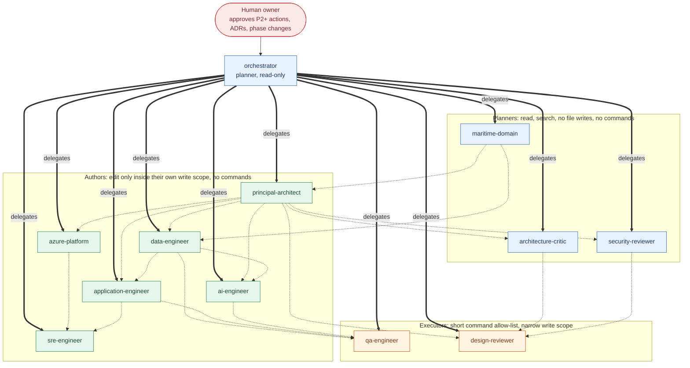
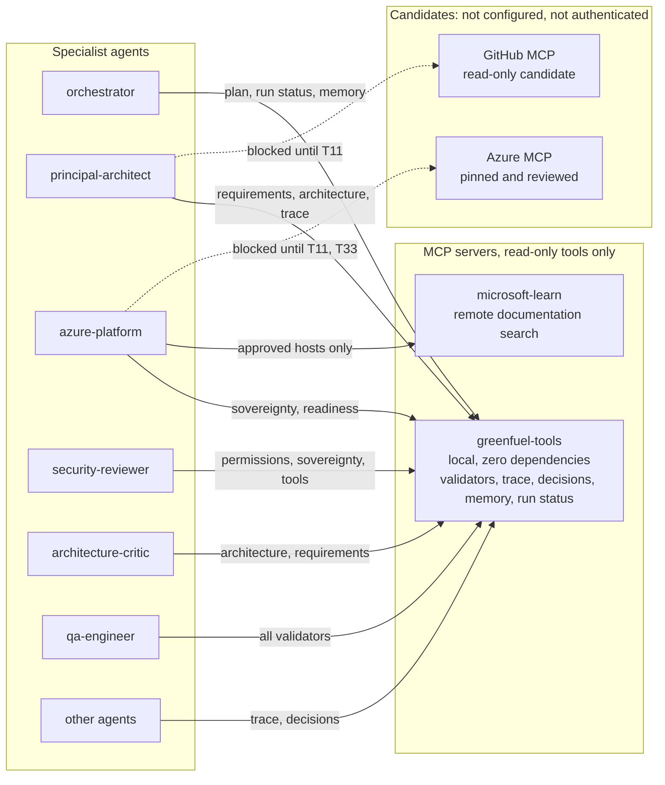
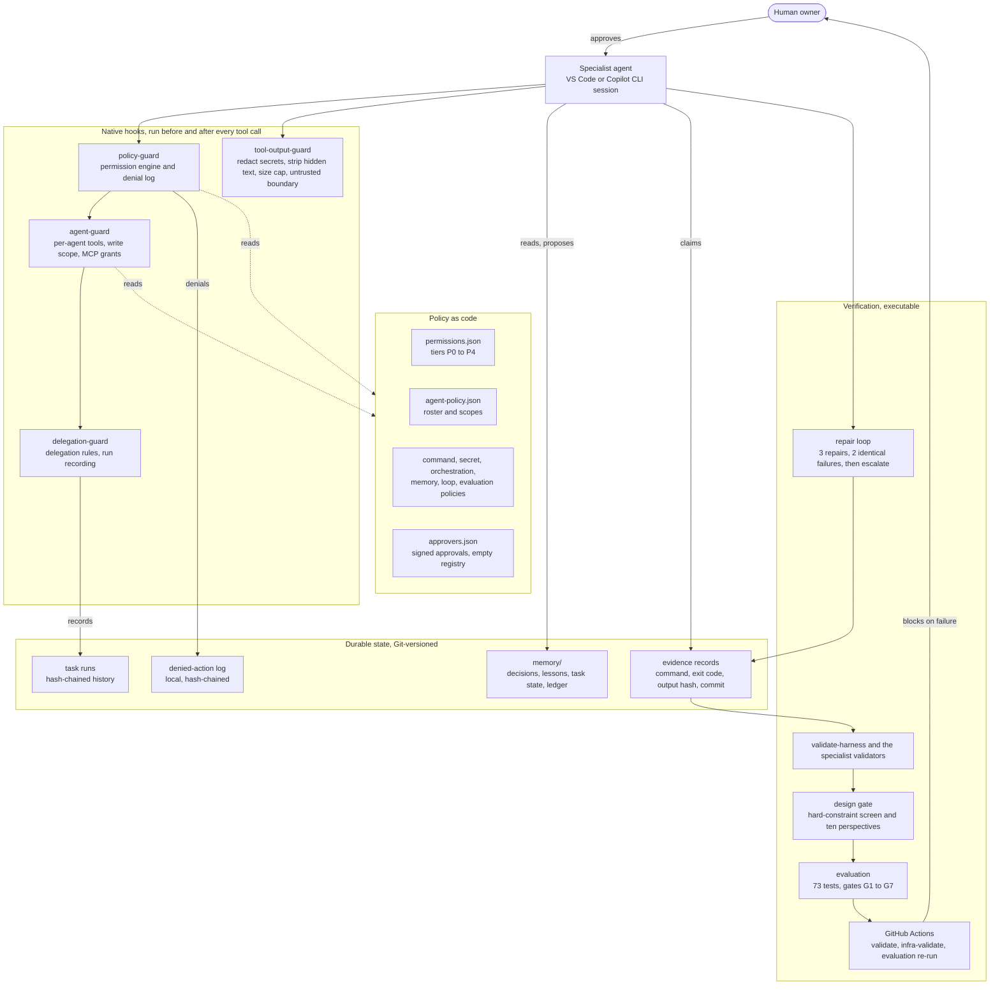

# Agent connectivity and relationships

How the twelve coding-harness specialist agents connect to each other, to their tools and to the control plane. These are **coding-harness agents**. The five production business agents (Delivery Evidence, Emissions Attribute, Dispute Resolution, Mass-Balance, Customer Compliance) do not exist yet and are kept separate by design.

The source of truth is [agent-policy.json](../../harness/policy/agent-policy.json) and the files in [.github/agents](../../.github/agents). A test ([agent-connectivity.test.mjs](../../tests/agent-connectivity.test.mjs)) fails if an agent, a delegation or a prerequisite edge in the policy is missing from diagram 1 or from the table below, so this page cannot silently drift. The diagrams show what is configured and enforced by tests; they do not show observed behaviour in VS Code (TODO T9, T12, T38).

## 1. Agent roster, delegation and prerequisites

Solid arrows are native delegation (`agents:` allow-list, recorded by the delegation hook). Dotted arrows mean "its output is a prerequisite of" and are checked for cycles; they are not delegation. Only the orchestrator may delegate, and no agent may delegate back, so a cycle is impossible.

| Agent | Class | May write (Phase 0) | May write once the owner raises the phase | Commands | Prerequisite inputs from |
|---|---|---|---|---|---|
| orchestrator | planner | nothing | nothing | none | none |
| principal-architect | author | designs, ADRs, risk register, state | nothing | none | maritime-domain |
| maritime-domain | planner | nothing | nothing | none | none |
| azure-platform | author | docs/design/azure | infra | none | principal-architect |
| application-engineer | author | docs/design/application | src/api, src/web, src/integration | none | principal-architect, data-engineer |
| ai-engineer | author | docs/design/ai | src/agents, evals | none | principal-architect, data-engineer |
| data-engineer | author | docs/design/data | src/data, src/calc, db | none | principal-architect, maritime-domain |
| security-reviewer | planner | nothing | nothing | none | principal-architect |
| sre-engineer | author | docs/design/operations, runbooks | ops | none | azure-platform, application-engineer |
| qa-engineer | executor | docs/design/test | tests/product | seven allow-listed | application-engineer, data-engineer, ai-engineer |
| architecture-critic | planner | nothing | nothing | none | principal-architect |
| design-reviewer | executor | architecture reviews | nothing | three allow-listed | principal-architect, architecture-critic, security-reviewer |

"Phase 0" is the current phase: design and governance only. The second write column is configured but inert until the owner raises the phase through an ADR (HC-11); nothing in this repository does that.

## 2. What each agent can reach

Per-agent tool lists are in [TOOL-REGISTRY](TOOL-REGISTRY.md) and are generated from the registry, not written by hand.

## 3. Control plane around the agents

Everything an agent does passes through deterministic checks that are code, not prompts. The hook is a screen and not a security boundary: agents run as the user's operating-system account (TODO T15, roadmap R15).

## 4. Where the six pillars sit

| Pillar | Components in the diagrams | Honest status |
|---|---|---|
| Tools | MCP servers, tool registry, tool-output-guard | Verified for local read-only tools; Azure and GitHub MCP not configured |
| Context | context-loading profiles, requirements baseline, hard constraints, design gate | Verified for consistency; live loading unverified (R11) |
| Execution | orchestrator, delegation-guard, task runs | Verified in Copilot CLI; VS Code owner-reported |
| Permissions | policy-guard, agent-guard, permission policy, approvers | Hook-level only; no sandbox, no real approver, no branch protection |
| Memory | memory store, ledger, task state | Verified with fixtures; no VS Code restart tested |
| Loop | repair loop, evidence records, evaluation | Verified in scenarios; no sandbox for code under test |

The full classification with evidence is in [HARNESS-ACCEPTANCE-REPORT](../acceptance/HARNESS-ACCEPTANCE-REPORT.md).

## 5. Comparison with the reference repository

The reference ([AICodingAgentHarness](https://github.com/astha29may/AICodingAgentHarness)) draws a single left-to-right pipeline of build agents: problem statement, architecture, plan, parallel build, verification, with an iterate-or-pass loop back to the build orchestrator and then documentation. This harness differs on purpose: a hub-and-spoke delegation from one read-only orchestrator, prerequisite edges between specialists instead of a build pipeline, a review and challenge lane that cannot write, and a control plane that is enforced in code. See [REFERENCE-ASSESSMENT](REFERENCE-ASSESSMENT.md).
