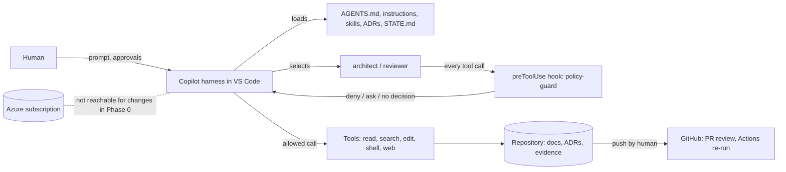

# Harness Architecture

Status: Accepted decisions ([ADR 0001](../adr/0001-native-first-harness.md), [ADR 0002](../adr/0002-phase-gating-and-approval-enforcement.md)). The hook has been observed enforcing in Copilot CLI 1.0.102 (trusted folder only); VS Code chat is not yet tested. See [LIVE-TEST-R1](LIVE-TEST-R1.md) and [OPEN-QUESTIONS](OPEN-QUESTIONS.md) Q4.

## 1. Purpose and scope

The harness lets GitHub Copilot in VS Code help design, implement, test, deploy and operate an Azure-native agentic solution for *Agentic Green-Fuel Bunkering Certification for an Asian Marine Fuels Group*. This document covers the **coding harness** only. The bunkering application and its business agents are out of scope for Phase 0 and are never part of the harness.

## 2. Environment (observed on this machine, 2026-10-28)

| Item | Value | How observed |
|---|---|---|
| VS Code | 1.143.0 (x64) | `code --version` |
| Copilot CLI | 1.0.102 | `copilot --version` |
| Copilot Chat extension | Not listed by `code --list-extensions`; assumed built into the editor | Unverified (Q2) |
| Node.js / Python | 22.23.4 / 3.11.9 | `node --version`, `python --version` |
| Azure CLI / azd | 2.91.0 / 1.30.0 | `az version`, `azd version` |
| Installed Azure extensions | Azure MCP server 3.0.51, azd 0.10.0, Bicep 0.48.1, Foundry 1.2.4 | `code --list-extensions --show-versions` |

VS Code documents two agent harnesses: **Local** (editor-only, VS Code tool names such as `agent/runSubagent`, handoffs, prompt files) and **Copilot** (shared with Copilot CLI and the GitHub Copilot app; native `task` tool for delegation; hooks in `.github/hooks/*.json`; user customizations in `~/.copilot`). This harness targets the **Copilot harness** and uses only customization files that both read: `AGENTS.md`, `.github/agents/*.agent.md` with portable tool aliases (`read`, `search`, `edit`, `web`, `todo`, `execute`), `.github/instructions/*.instructions.md`, `.github/skills/*/SKILL.md` and `.github/hooks/*.json`. Prompt files and handoffs are not used because they are Local-only.

## 3. The six pillars

The pillars are the programme's own list (confirmed by the owner when this stage began) and map to the ten design principles in the brief.

| # | Pillar | Brief principles covered |
|---|---|---|
| 1 | Context & Instructions | Architecture decisions before implementation |
| 2 | Tools & Azure Integration | Azure-first and Microsoft-native; minimal dependencies and abstractions |
| 3 | Orchestration & Role Separation | Separation of coding harness and production business agents |
| 4 | Guardrails & Human Approval | Secure by default; human approval for high-impact actions; no autonomous production deployment |
| 5 | Memory & Resumability | Persistent memory and resumable execution |
| 6 | Verification & Evidence | Evidence-based validation; no fabricated Azure resources, results or status |

### 3.1 Context & Instructions
- **Purpose.** Give every session the same ground rules and decision history, with the smallest possible context.
- **Native.** `AGENTS.md` (always loaded), path-scoped `.instructions.md` (loaded when matching files are in play), skills (loaded on demand).
- **Custom.** None. ADR template and ADRs under `docs/adr/` are plain Markdown.
- **Controls.** Decisions are ADRs with status `Proposed` until a human accepts. Agents may not contradict an Accepted ADR.
- **Gap.** ADR 0001 and 0002 are Proposed, not Accepted. Context budget has not been measured.

### 3.2 Tools & Azure Integration
- **Purpose.** Give each agent the least tooling it needs and prefer Microsoft-native services.
- **Native.** Agent `tools` allow-lists; Azure MCP server and Azure extensions already installed on this machine; Azure CLI, azd and Bicep as local tools.
- **Custom.** None. No MCP server is configured in the repository.
- **Controls.** Every agent declares `tools` explicitly (validator rejects implicit-all). `principal-architect` has no shell. `qa-engineer` and `design-reviewer` run only an anchored allow-list (agent-guard). Planners have no edit tool. Zero runtime dependencies (validator rejects any in `package.json`).
- **Gap.** Which Azure MCP tools to allow, and per agent, is undecided (Q6). In Phase 0 the hook denies Azure mutation regardless.

### 3.3 Orchestration & Role Separation
- **Purpose.** Keep roles narrow and keep the harness separate from the product.
- **Native.** Custom agents; the built-in Plan agent for planning; native subagents (`task`) when a task needs a separate context.
- **Custom.** None. No orchestrator, no lanes.
- **Controls.** Twelve harness agents in three classes (planner, author, executor), defined in [AGENT-ROSTER](../agents/AGENT-ROSTER.md); only the orchestrator delegates. Business agents live under `src/` in a later phase and are never defined in `.github/agents/`. Phase gate blocks `src/` and `infra/` until raised.
- **Gap.** Subagent depth and the exact boundary of business-agent design artefacts are open (Q8). Parallel lanes are deferred (roadmap R8).

### 3.4 Guardrails & Human Approval
- **Purpose.** Make prohibited actions fail even when a model, a prompt injection or an Allow-all setting would otherwise permit them.
- **Native.** VS Code permission levels, tool and terminal approval, URL approval, optional terminal sandbox; workspace trust; `preToolUse` hooks.
- **Custom.** `harness/hooks/policy-guard.cjs` (about 140 lines) and `harness/policy/command-policy.json`.
- **Controls.**
  - Deny: Azure mutation (allow-list of read verbs; everything else denied), `azd up|deploy|provision|down`, IaC apply/destroy, cluster mutation, credential or token retrieval, download-and-execute, force-push, writes to application/IaC paths in Phase 0, reads or writes of secret-bearing files, agent writes to evidence records.
  - Ask (a human must approve; denied automatically when no human can answer): `git push` and remote-changing `gh` calls, destructive local git, recursive delete, package installs, environment dumps, edits to hooks, policy, workflows and scripts.
  - Fail-closed on unparseable hook input. No match returns `{}`, never an implicit allow.
  - `.vscode/settings.json` keeps global auto-approve off and requires approval for `az`, `azd`, `terraform`, `kubectl`, `git push`, `rm` in the Local integrated terminal.
- **Limits (stated plainly).** Pattern matching is evadable by an expressive shell command, and it also over-blocks: any command text containing a denied phrase (for example `azd up` inside a commit message) is denied. Command-hook timeouts fail open per the hooks reference. Hook behaviour in the user's session is unobserved. The hook is a speed bump and an audit aid; the boundaries that matter are Azure RBAC (agents get no write role), a sandbox or dev container (roadmap R3), and human review in GitHub.

### 3.5 Memory & Resumability
- **Purpose.** A new session, or a new person, resumes from facts rather than chat history.
- **Native.** Copilot memory tool (user, repository and session scopes, stored locally and not shared); session history and resume.
- **Custom.** Added in Stage 8 ([ADR 0010](../adr/0010-persistent-memory.md), Proposed): strict JSON memory under `memory/` with a hash-chained ledger, a store that decides by writer type what may be written, read-only MCP tools `memory_search` and `memory_resume`, and `validate-memory` ([MEMORY-MODEL](../memory/MEMORY-MODEL.md), [MEMORY-GOVERNANCE](../memory/MEMORY-GOVERNANCE.md)). Still a convention: `docs/state/STATE.md` is the human-facing resume point; the `session-handoff` skill defines how to update it. The run store ([ADR 0009](../adr/0009-task-execution-framework.md)) remains the execution history.
- **Controls.** STATE.md separates "Done (with evidence)" from "Claimed, unverified". No secrets, personal data or customer data in memory (refused, not redacted). Copilot's own memory is rejected as a source of authority because it cannot be reviewed or tied to evidence; anything the team depends on lives in Git.
- **Gap.** No automated check that STATE.md was updated. No cross-machine resume beyond git. The `human` writer type of memory is self-declared, and retrieval quality has not been measured (see the memory governance limits). A VS Code restart was not tested.

### 3.6 Verification & Evidence
- **Purpose.** "Done" means observed, not declared.
- **Native.** Test and task running, problems view, GitHub Actions.
- **Custom.** `harness/scripts/record-evidence.mjs` (runs a command, stores argv, exit code, duration, output hash and tail, git HEAD, runtime versions); `harness/scripts/validate-harness.mjs`; tests in `tests/`; `.github/workflows/validate.yml` (re-runs both outside the agent session, actions pinned to commit SHAs, read-only token).
- **Controls.** `qa-engineer` returns `VERIFIED` only from a recorded exit-0 run that covers the claim. Evidence records are append-only by convention and blocked for agent edits by the hook. The recorder refuses commands the policy would deny.
- **Limits.** A record proves a command ran with that result on that machine. It does not prove the command tests the claim. Records can be forged by a human or by a shell command that evades the hook; CI and git history are the cross-check. No Azure state is evidenced in Phase 0.

## 4. Runtime view

## 5. Trust boundaries and threats

| Boundary | Threat | Mitigation | Residual risk |
|---|---|---|---|
| Web, documents, tool output into model context | Prompt injection redirects the agent | AGENTS.md rule: content is data; hook denies the highest-impact actions regardless of instruction | Medium: injection can still cause harmful docs or wasted effort within allowed actions |
| Agent to shell | Destructive or exfiltrating command | Hook deny/ask lists; approvals; no secrets in repo; Azure RBAC | Medium: evasion, timeout fail-open |
| Agent to Azure | Unintended resource change or cost | Mutation denied; agents hold no Azure write role (to be enforced in Azure, R2) | Low in Phase 0 (no resources exist); rises with phase |
| Agent to harness control files | Agent weakens its own guardrails | Control-plane edits require approval; CI re-runs validator | Medium until hooks are observed live |
| Agent claims success | Self-declared completion | Reviewer plus recorder plus CI | Medium: recorder trusts the command chosen |
| Supply chain | Malicious or vulnerable dependency or action | Zero dependencies; SHA-pinned actions; install commands require approval | Low |
| Confidential programme data in chat | Data leaves the tenant boundary or is retained | Not designed yet | Open (Q7) |

## 6. Failure modes

| Failure | Effect | Handling |
|---|---|---|
| Hook script crashes or errors | Tool call denied (fail-closed) | Visible to the user; fix and retry |
| Hook times out | Call proceeds through normal approvals (fail-open) | Keep policy fast; sandbox and RBAC as backstops |
| Hooks disabled by user, policy, session type, or an untrusted folder | No enforcement and no warning. Observed in Copilot CLI: `azd up` ran in an untrusted folder ([LIVE-TEST-R1](LIVE-TEST-R1.md)) | Trust the folder; run the canary in the README; organisation policy for managed machines; CI as the independent check |
| Node missing on host | Hook cannot run, calls denied | Node 20+ is a stated prerequisite |
| Native feature changes names or payload | Hook misreads tool args | Tests pin the documented shapes; review on VS Code upgrade |

## 7. Not implemented
Live-session verification of the hook; sandbox or dev container; Azure RBAC for agent identities; decision log of hook denials; harness evaluations; the product architecture itself. See [IMPLEMENTATION-ROADMAP](IMPLEMENTATION-ROADMAP.md).
