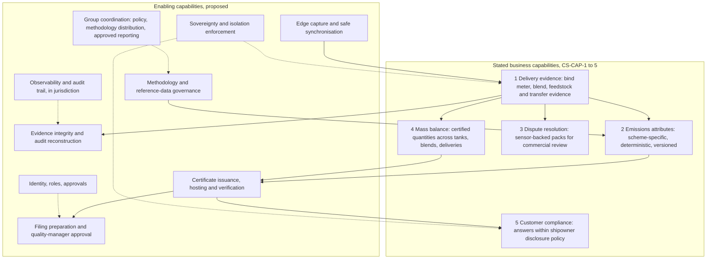

# 01 Business capability map

Status: proposed, Phase 0. The five business capabilities are **stated** (CS-CAP-1 to CS-CAP-5). The enabling capabilities are **proposed (B)**: they are what the stated five need in order to satisfy the mandatory constraints. A capability is not an agent: the mapping to agents and to deterministic services is itself a design decision ([ADR 0017](../adr/0017-deterministic-core-and-bounded-agents.md)).

## Capabilities, ownership and realisation

Realisation says what is deterministic software (L0) and where an agent adds value. Autonomy ceilings are the proposals in [AGENT-AUTONOMY-MATRIX](../context/AGENT-AUTONOMY-MATRIX.md) and **grant no permission** (HC-09).

| Capability | Source | Deterministic core | Agent role (optional per cell) | Proposed ceiling | Key requirements | Candidate business owner |
|---|---|---|---|---|---|---|
| Delivery evidence | A, CS-CAP-1 | Ingestion, device identity, sequence checks, hashing, binding, package manifest and completeness | Spot gaps and inconsistencies, classify documents, chase missing evidence, draft the package summary | L4 within a fixed catalogue | FR-001 to FR-006, FR-032, DATA-002, SEC-013 | Quality manager with port operations |
| Emissions attributes | A, CS-CAP-2 | Calculation engine, methodology packages, factor sets, result record, re-run | Request a calculation, assemble inputs, explain results with citations. **Never produces a number** | L4 for requests; no authority over methods | FR-007 to FR-012, DATA-005, DATA-007 | Quality manager |
| Dispute resolution | A, CS-CAP-3 | Pack assembly from records, verification instructions, meter status | Prepare packs, state what is and is not evidenced, propose structure for human review | L3: every outward step human | FR-013 to FR-016, FR-033 | Commercial reviewers (D-007) |
| Mass balance | A, CS-CAP-4 | Ledger, mass-conservation rules, balance checks, reconciliation | Draft explanations of exceptions, propose adjustments for approval | L4 for posting derived events; adjustments approved | FR-017 to FR-021, DATA-007 | Quality manager with terminal operator |
| Customer compliance | A, CS-CAP-5 | Policy evaluation before retrieval, per-shipowner partition, refusal codes | Answer in natural language from verified records only, citing record and methodology version | L4 with sampled review | FR-022 to FR-025, SEC-005, SEC-006 | Customer-facing team with shipowners |
| Certificate issuance, hosting, verification | B (needed by CS-C3) | Hash chain, signing, local hosting, offline verification bundle, supersession and revocation | None on the signing path | L0 | FR-026, FR-030, FR-031, SEC-007 | Quality manager |
| Filing preparation and approval | B (needed by CS-C4) | Approval service, content-hash binding, separation of duties, filing client | Draft filings for approval | L2 | FR-027, FR-028, SEC-010 | Quality manager |
| Methodology and reference-data governance | B (needed by CS-C5) | Versioned packages, lifecycle, effective dates, signatures | Summarise changes for reviewers | L0 | FR-012, DATA-005, SEC-015 | Quality manager with scheme owner |
| Evidence integrity and audit reconstruction | B (needed by CS-C8) | Append-only store, hash chains, anchoring, reconstruction query | Present a reconstruction in narrative form | L0 core, L1 narrative | FR-029, SEC-008, DATA-003 | Compliance with auditors |
| Edge capture and synchronisation | B (needed by CS-C7) | Capture service, trusted clock, durable queue, idempotent sync | None | L0 | FR-006, NFR-004, NFR-005, SEC-013 | Barge and terminal operators |
| Sovereignty and isolation enforcement | B (needed by CS-C1, CS-C2) | Placement rules, flow allow-list, partitioning, policy engine | None | L0 | SEC-001 to SEC-006, DATA-001 | Compliance |
| Identity, roles, approvals | B | Workload and user identities, role assignment, approval service | None | L0 | SEC-009, SEC-010, SEC-011 | Security |
| Observability and audit trail | B | In-cell telemetry, audit ledger, alerting | Summarise incidents | L0 core | SEC-014, NFR-001 | Operations |
| Group coordination | B | Methodology distribution, policy distribution, approved-flow reporting, fleet health | None | L0 | SEC-004, D-011 | Programme owner |

## Where the agents earn their place

The case calls the product "agentic" (CS-P1), but constraints CS-C5 and CS-C6 keep every number and every status in deterministic code. That leaves the agents with orchestration, gap-finding, drafting, retrieval and explanation. This is where the value is **hypothesised**, and each hypothesis must be proven by the evaluation framework before it is relied on (AS-021, [BUSINESS-CASE](../context/BUSINESS-CASE.md) section 4):

| Hypothesis | Capability | How it would be proven | Model input it feeds |
|---|---|---|---|
| Agents cut the hours spent assembling and chasing evidence | Delivery evidence | Time per package with and without the agent on a fixture set | h_evidence_tobe |
| Agents reduce the effort to prepare filings and dispute packs | Filing, dispute resolution | Time to a reviewable draft; reviewer corrections per draft | h_filing_tobe, h_dispute_tobe |
| Agents answer customer questions without staff | Customer compliance | Share of enquiries answered correctly and within policy; zero cross-customer disclosure | indirect (staff time, not modelled) |
| Audit preparation shrinks because reconstruction is one step | Integrity and audit | Time to answer a sampling request | h_audit_tobe |

If most of the measured value comes from the deterministic parts (binding, calculation, certificate, reconstruction), the honest summary is that the case for "agentic" rests on orchestration and natural-language access. That is reported, not hidden.

## Business value drivers by capability

The model ([BUSINESS-VALUE-MODEL](../business/BUSINESS-VALUE-MODEL.md)) reduces value to five streams. All inputs are scenario assumptions awaiting measured data.

| Stream | Capabilities behind it | Model inputs |
|---|---|---|
| Certificate labour | Delivery evidence, emissions attributes, filing | h_*_base, h_*_tobe, rate_* |
| Dispute cost and concessions | Dispute resolution, integrity | dispute_rate, h_dispute_*, writeoff_* |
| Audit preparation | Integrity and audit reconstruction | audits_per_year, h_audit_* |
| Green-fuel premium protected | Certificates, integrity, customer compliance | premium_usd_t, risk_base, risk_tobe |
| Incremental volume | Customer compliance, certificates | incremental_share, margin_usd_t |
