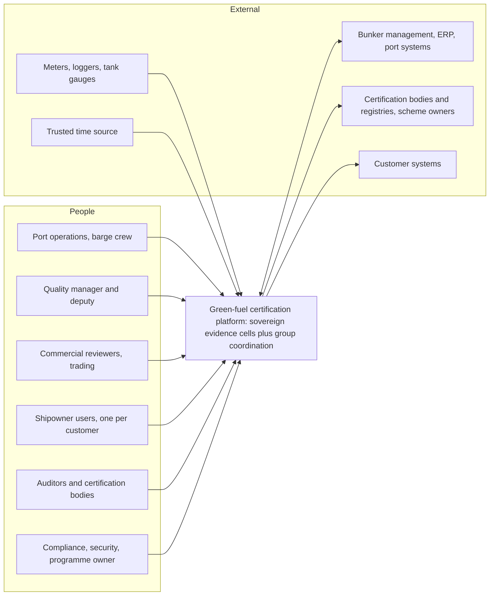
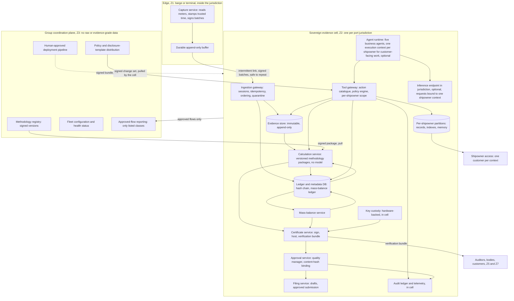
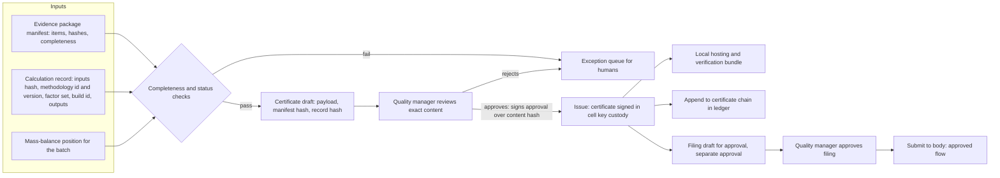
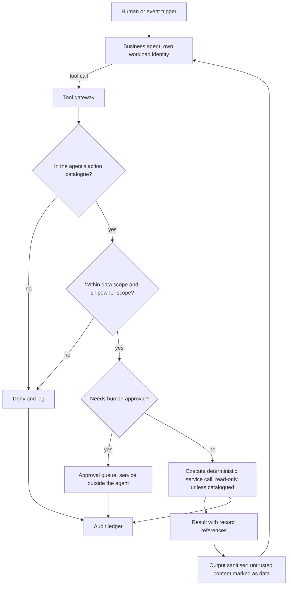
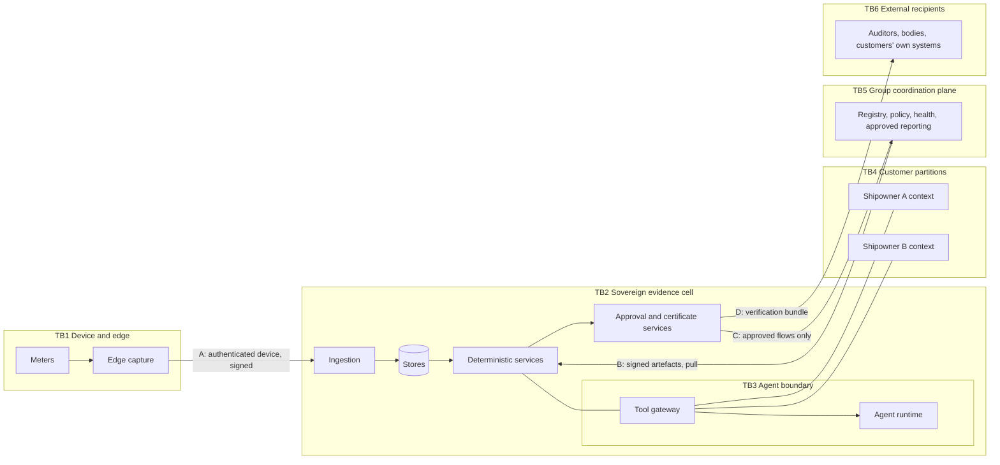
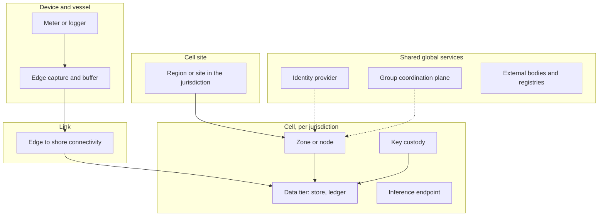
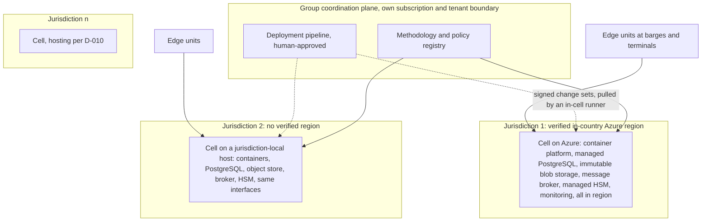

# 03 Architecture views

Status: proposed, Phase 0. Diagrams show roles, boundaries and flows. They name no SKU, are not network designs and have **not been rendered locally** (GitHub renders Mermaid). Zones are those in the [sovereignty matrix](../context/SOVEREIGNTY-MATRIX.md): Z1 edge, Z2 shore platform in the originating jurisdiction (the **cell**), Z3 group hub in another jurisdiction, Z4 cloud or AI service not pinned to the jurisdiction, Z5 customer environment, Z6 personnel outside the jurisdiction, Z7 external recipients. Data classes are DC-01 to DC-18 from [DATA-CLASSIFICATION](../context/DATA-CLASSIFICATION.md). Everything below is subject to the recommendation in [02](02-ARCHITECTURE-OPTIONS.md) and to D-003, D-009, D-010, D-011.

## 1. System context

External interfaces are candidates: meter and system landscape unknown (D-019, D-035); schemes and bodies unknown (D-001, D-006). Filing to a body leaves the cell only after quality-manager approval and only on an approved flow.

## 2. Container view

Key properties:

- Everything that stores or derives from delivery measurements is inside the cell (Z2). The group plane is downstream-biased: it pushes signed artefacts to cells, and cells pull and verify them. Cells push upward only the listed classes.
- The **edge** is a buffer. It never decides, never issues and holds no system of record.
- The **calculation service has no model on its path** (HC-05, HC-06). The agent runtime reaches data only through the **tool gateway**, which enforces the action catalogue, the shipowner scope and the policy bundle. Instructions to an agent are not a control (HC-09).
- The **approval service** is outside any agent's context (AS-014). Agent identities cannot hold the approval permission (SEC-010).
- **Isolation extends to the inference path (HC-02).** Customer-facing work runs in an execution context bound to one shipowner: the inference request carries a tenant-bound identity; server-side prompt, prefix and key-value caches, batching, retries, traces and logs are namespaced per shipowner and never shared across shipowners; no session or conversation context is reused across shipowners; and provider-side retention is off or verified. Where the inference service cannot guarantee this, a dedicated deployment per shipowner or no inference for that cell is the alternative. This is a requirement on any candidate endpoint, to be tested (see TM-16 and TM-34), not an assumption that one exists.
- **Deployment is pull-based and in-jurisdiction.** The group plane only *publishes* signed change sets. Each cell has its own deployment runner with an in-jurisdiction identity that pulls, verifies and applies them; that identity cannot read or export production data, and deployment logs stay in the cell. Nothing in Z3 holds credentials to change a cell (SEC-002).

## 3. Component view: the certificate and approval path

The two approvals are different actions on different content hashes: one for issuing, one for each filing. A change of content invalidates the approval (HC-04, SEC-010). Corrections create a new version, never an overwrite (FR-030).

## 4. Component view: the agent boundary

Untrusted inputs (feedstock documents, customer messages, tool output) are data and never change policy or permissions (SEC-012). The catalogue, scope and approval checks sit in the gateway and the platform's role assignments, not in a prompt.

## 5. Data flows

Each flow lists the data classes and the zone crossing. A flow with a zone crossing outside Z1 to Z2 needs an approved-flow entry (D-011, SEC-004) and is **not permitted by default**.

| Flow | From | To | Data classes | Zone crossing | Default |
|---|---|---|---|---|---|
| F1 Meter readings and blend data | Meter, logger | Edge capture | DC-01, DC-03 | Inside Z1 | Allowed |
| F2 Signed batches | Edge buffer | Cell ingestion | DC-01, DC-03, DC-04 | Z1 to Z2, same jurisdiction | Allowed |
| F3 Evidence binding and packages | Ingestion | Evidence store and ledger | DC-01 to DC-04 | Inside Z2 | Allowed |
| F4 Calculation request and result | Calculation service | Ledger | DC-05, DC-06 | Inside Z2 | Allowed |
| F5 Mass-balance posting | Mass-balance service | Ledger | DC-07 | Inside Z2 | Allowed |
| F6 Certificate issue and verification bundle | Certificate service | Auditor, customer, body | DC-08 | Z2 to Z5 or Z7 | Allowed only as an offline-verifiable bundle on an approved flow |
| F7 Filing submission | Filing service | Certification body or registry | DC-09 | Z2 to Z7 | Only after the quality manager's approval, on an approved flow |
| F8 Customer question and answer | Shipowner user | Tool gateway and agent | DC-11, DC-12, derived from DC-06, DC-08 | Z5 to Z2 | One customer per context; policy evaluated before retrieval |
| F9 Methodology and policy distribution | Group plane | Cell | DC-05, DC-12 templates | Z3 to Z2, inbound only | Allowed; signed and verified; carries no jurisdiction data |
| F10 Approved-flow reporting | Cell | Group plane | Listed derived classes only (candidates: certificate status, digest hashes, aggregate balances; D-011) | Z2 to Z3 | **Denied until the list is decided** |
| F11 Telemetry and logs | Components | In-cell monitoring | DC-13, DC-14 | Inside Z2 | Allowed; export only on an approved flow (SEC-014) |
| F12 Inference | Agent runtime | In-jurisdiction inference endpoint | DC-02, DC-06, DC-08, DC-11 | Inside Z2 | Allowed only where the endpoint's processing location is verified (D-028) |
| F13 Deployment | Group plane publishes signed change sets; the cell's in-jurisdiction deployment runner pulls them | Cell | DC-17 | Z3 to Z2, inbound pull only | Human-approved; the runner cannot read or export production data; no real data in the pipeline (DATA-009) |

## 6. Trust boundaries

| Boundary | What crosses | Controls that must hold at it | Requirements |
|---|---|---|---|
| TB1 Device and edge to cell (A) | Signed batches, device identity, sequence | Device authentication, signed software, trusted clock, replay and gap detection, quarantine of unauthenticated input | SEC-013, FR-006, DATA-002, D-021 |
| TB2 Cell perimeter | Everything the cell holds | Jurisdiction placement, no cross-jurisdiction replication, in-cell logs and keys, admin access from inside only, break-glass inside | SEC-001, SEC-002, SEC-014, NFR-009 |
| TB3 Agent boundary | Tool calls and results | Action catalogue, scope, approval gate, output sanitising, no secrets in context, separate identities | HC-09, SEC-009, SEC-012, AGT-002 |
| TB4 Customer partition | Customer records, indexes, caches, memory, credentials | Separate partition per shipowner; policy before retrieval; test that A cannot reach B | HC-02, SEC-005, SEC-006, NFR-010 |
| TB5 Group coordination (B, C) | Signed methodology and policy down; listed classes up | Signature verification, allow-listed schemas, outbound-only, no raw data, no free-text fields | SEC-004, SEC-015, D-011 |
| TB6 External recipients (D) | Verification bundles, filings | Offline verifiability, approval before filing, approved flow entry, auditor access inside the jurisdiction | HC-03, HC-04, SEC-007, AS-024 |

## 7. Failure domains

| Failure domain | Fails | What keeps working | What stops | Recovery |
|---|---|---|---|---|
| Meter or logger | Source of readings | Other sources; the gap is recorded | Complete evidence for that delivery until resolved | Replacement; the delivery is flagged, never filled in (HC-06) |
| Edge device | Capture and buffer | Another edge unit if duplicated (D-018); delivery is evidenced by paper fallback process, flagged | Digital capture at that site | Replace and re-key; buffered data is recovered from the durable buffer if intact; loss is detected by sequence gaps |
| Edge-to-cell link | Synchronisation | Capture, local verification, queueing | Shore-side binding, calculation, certificate | Resume in order, idempotently; gaps reported (HC-07, NFR-005) |
| Cell zone or node | One availability zone or node | The cell, if zone-redundant (to be verified in region) | Nothing if redundancy holds | Automatic, in the jurisdiction |
| Cell data tier | Store or ledger | Edge capture; verification of issued certificates | Binding, calculation, issuance | Restore from in-jurisdiction backup; point-in-time; targets undecided (D-031) |
| Key custody | Signing keys unavailable | Capture, binding, calculation; verification of existing certificates | Issuance | Custody mechanism undecided (D-013); backup of keys stays in the jurisdiction |
| Inference endpoint | Agent features | **Everything deterministic:** evidence, calculation, certificates, approvals | Agent drafting and customer natural-language answers | Fall back to templated answers and human work; never to an out-of-jurisdiction endpoint |
| Cell site | The whole cell | Other cells; offline verification of issued certificates | That jurisdiction's processing until recovery | Second site in the same jurisdiction or verified region pair (RK-013) |
| Group plane | Methodology and policy distribution, group views | **Every cell**, using cached signed versions | New methodology versions, group dashboards | Cells continue on the last verified version; staleness is visible |
| Identity provider | Sign-in, approvals | Capture, binding, calculation using workload identities with cached tokens; verification | New human sessions and approvals | Break-glass inside the cell (SEC-002); a degraded mode must be designed and tested (D-027, D-033) |
| External body or registry | Filing endpoint | Everything inside | Filing | Filing stays queued in a prepared state; no autonomous retry that changes content |

## 8. Deployment topology

| Aspect | Design | Open |
|---|---|---|
| Unit of deployment | One cell per jurisdiction, identical definition, parameterised per jurisdiction | Number and list of jurisdictions (D-003) |
| Hosting adapter | Azure-region cell, or jurisdiction-local cell, chosen per port from the hosting matrix | Which ports qualify for which (D-009, D-010); verified availability of each needed service per region |
| Environments | Development, test and production are **separate subscriptions or hosts**. Non-production uses synthetic or approved-masked data only and never real delivery data (DATA-009) | Number and placement of non-production environments per jurisdiction (D-036, D-037) |
| Identity | Workload identities per component and per agent; human identities federated; no standing broad roles | Whether the identity provider's global scope is acceptable per jurisdiction; support access model (D-033) |
| Deployment | Infrastructure as code, human-approved, **publish and pull**: the group plane publishes signed change sets and each cell's in-jurisdiction runner applies them with least-privilege identities that cannot read data; no agent deploys, no autonomous production deployment (HC-11) | Deployment is deferred by the owner (T36); runner design and break-glass inside the cell |
| Network | Private connectivity inside the cell, outbound-only to group plane, no public endpoints on data stores | Network design not done |
| Capacity | Small per cell in the scenarios; fixed per-cell costs dominate ([05](05-QUALITY-ATTRIBUTES.md)) | D-031, D-032 |
